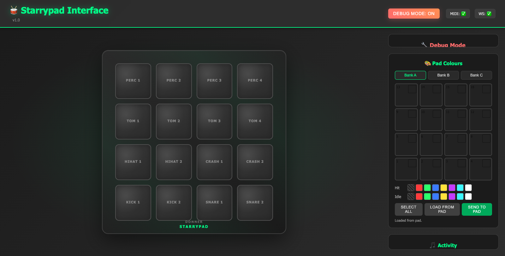

# Starrypad Interface

Control the **Donner STARRYPAD** from Node.js and the browser. The pad's LED colours are stored on the
device and can only be set through an undocumented SysEx protocol; this repo documents that protocol
([STARRYPAD-PROTOCOL.md](STARRYPAD-PROTOCOL.md)) and implements it, together with a realtime web UI
that mirrors the 4×4 pads and plays synthesized percussion.



Not affiliated with or endorsed by Donner.

## Features
- **Pad LED colours** per pad and bank (hit and idle colour, 8-colour palette), written over SysEx and
  verified by reading them back: from the web UI, a REST API, a CLI, or as one-shot animations.
- **Protocol spec**: USB/MIDI transport, handshake, config dump and write, block layout, factory table,
  and the quirks that matter in practice (e.g. the pad reboots on SysEx while it is sending).
- **Library** for your own apps: protocol helpers plus a long-running connection that reconnects after
  unplugging and queues config writes safely.
- **Web UI** (`public/`) mirroring the pad layout with Web Audio drum sounds; clicking pads works
  without hardware.
- **Tools**: decoded MIDI monitor, logging proxy for reverse engineering, LED feedback probe.

## Requirements
- Node.js 18 or newer.
- A Donner STARRYPAD (tested with firmware `V20210207`). Other MIDI pads work for the drum UI, but not
  for the colours.
- Native build tools for the `midi` package: Xcode Command Line Tools on macOS, Build Tools for Visual
  Studio on Windows, or `build-essential` plus ALSA headers on Linux. Developed and tested on macOS.

## Setup and running
```bash
npm install
npm start       # or: npm run dev (auto-reload)
```
The server runs on `http://localhost:3001`; override with `PORT=4000 npm start` or a `.env` file.
It connects to the first MIDI input whose name contains `starry`, `donner` or `pad` (otherwise the first
input, for testing) and picks the pad up again after it was unplugged.

> **Don't touch the pad while colours are being written.** SysEx that reaches the pad while it is
> sending (a fader still moving) makes it restart. The server waits for 1.5 s of silence before every
> write, so a write can take a moment to start.

## Pad LED colours
Each pad has a **hit** colour and an **idle** colour per bank (A/B/C), chosen from
off, red, green, blue, yellow, purple, cyan, white. There is no RGB or brightness.

- **Web UI:** "Pad Colours" panel: pick a bank, click pads, choose hit/idle colours, *Send to pad*.
  The big on-screen pads mirror bank A's real colours.
- **REST:** `GET /api/pads/colors` → `{ colors: { A: { hit: [16], idle: [16] }, B, C } }`;
  `PUT /api/pads/colors` with `{ "changes": [{ "bank": "A", "pad": 1, "hit": "red", "idle": "off" }] }`.
  Pad 1 = bottom-left, 16 = top-right. Every write is read back and verified; clients get a `padColors` event.
- **CLI** (server not needed):
  ```bash
  npm run colors -- show
  npm run colors -- set all all hit=green idle=green   # banks: A | A,C | all; --dry-run to preview
  npm run colors -- backup my-pad.json                 # / restore my-pad.json
  ```
- **Animations** (play once, then restore the previous colours):
  ```bash
  npm run animate -- --list            # rainbow, wave, rise, ripple, spiral, sparkle, snake, pong, checker
  npm run animate -- wave              # --banks A, --keep (leave last frame), --dry-run (preview)
  ```
  Each frame is a full stored-config write (~0.65 s, presumably to flash), so keep animations occasional.

## Use it as a library
```js
import { StarrypadConnection } from 'starrypad-interface';

const pad = new StarrypadConnection().start();       // auto-connects, reconnects after a replug
pad.on('midi', ({ type, channel, number, value }) => console.log(type, number, value));

// Queued, waits until the pad is quiet, writes all 13 blocks and verifies the read-back
await pad.updateColors([{ bank: 'A', pad: 1, hit: 'white', idle: 'red' }]);
await pad.writeConfig((config) => config.setPadColor('B', 16, 'idle', 'purple'));
```
`lib/starrypad.js` has the pure protocol parts (message builders, parser, `StarrypadConfig` with
`getPadColor`/`setPadColor`/`getAllColors`, `StarrypadConfig.factory()`) and a small `StarrypadDevice`
transport for one-off scripts. Install it from another project with
`npm install github:ingo-eichhorst/starrypad-interface` or `npm install ../starrypad-interface`.

## API and WebSocket events
- `GET /api/status` → MIDI connection, debug mode, pad mapping, connected clients.
- `GET /api/midi/devices` → detected input ports; `POST /api/midi/connect/:deviceId` → switch port.
- `POST /api/debug/toggle` or WebSocket `toggleDebug` → enable/disable debug broadcasts.
- WebSocket events: `status`, `midiConnected`, `midiDisconnected`, `padHit`, `midi` (every note and CC,
  for clients that do their own mapping), `padColors`, `debugMIDI`, `unknownNote`, `debugModeChanged`.

## Tools
- `npm run monitor` – prints everything the pad sends, decoded (pads per bank, knobs, faders, buttons);
  `--pressure` adds the aftertouch stream.
- `npm run proxy` – logging proxy ("STARRYPAD Proxy" virtual port) that records what another app, e.g.
  Donner's editor, sends to the pad. This is how the protocol was decoded; see the spec, §9.
- `npm run probe` – checks MIDI in, SysEx replies and whether Note On/CC messages light the LEDs.
- `captures/` – an editor session log and the tested unit's config before the first write from this code.

## Troubleshooting
- Colour requests fail with "Pad did not answer": replug the pad (or open the Donner editor once) and retry.
- Native build errors during `npm install`: install the platform build tools listed above and retry.
- The pad restarted during a colour write: it was sending (fader, knob, held pad) when the SysEx arrived.
  Let go of it and write again.
- Browsers may suspend audio until user interaction; click anywhere in the page if you hear nothing.

## License
MIT, see [LICENSE](LICENSE).
